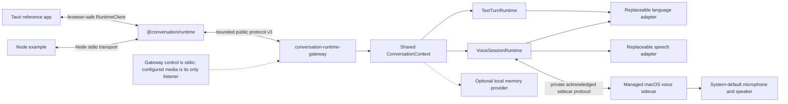
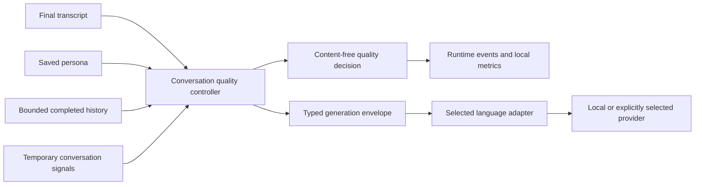
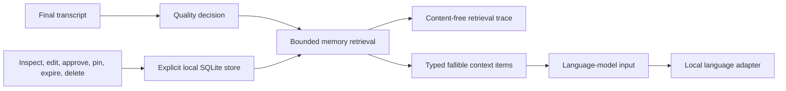

# Architecture

## Dependency Direction

```text
protocol <- model-adapters <- runtime
protocol <- memory         <- runtime
```

`protocol` defines client-visible commands, events, identifiers, and failures. It has no dependency on Tokio, model implementations, or runtime internals.

`model-adapters` defines the capabilities required from language and speech models. Its mock implementations are deterministic test doubles, not deployment backends.

`memory` defines a backend-neutral context-provider boundary and the explicitly
initialized SQLite reference store. It depends on portable protocol types, not
on runtime orchestration or model-specific payloads.

`runtime` owns turn state, adapter coordination, event ordering, and cancellation. Clients should not depend on adapter implementation details.

## R6 SDK, Reference Host, and Desktop App

R6 keeps the public SDK, runtime, local reference host, and product UI as
separate ownership boundaries:



### Ownership

- **Public SDK:** validates public protocol-v1 commands, acceptances, status,
  typed and voice lifecycle events, frame bounds, request correlation, and
  reusable lifecycle handles. It contains no provider or desktop policy.
- **Runtime:** owns monotonic turn/generation identifiers, one-active-turn
  arbitration, completed bounded context, persona and quality decisions,
  optional memory retrieval, cancellation, backpressure, and exactly one
  terminal lifecycle event across typed and spoken input.
- **Gateway reference host:** loads one explicit private configuration, composes
  the selected offline or online adapters, owns the shared runtime/context,
  exposes bounded framed stdio, and reaps gateway/provider/sidecar work on Stop,
  EOF, failure, or close. A configured media endpoint is its only listener;
  loopback plaintext is test-only and non-loopback requires TLS plus the
  session-scoped credential.
- **Desktop reference app:** owns setup presentation, explicit microphone
  intent, Voice Focus preferences, accessibility behavior, and app transcript
  history. It consumes only the browser-safe SDK and does not import runtime,
  provider, sidecar, or SQLite internals.

Four-byte big-endian length prefixes frame bounded versioned JSON over child
stdin and stdout. Standard error carries only bounded content-free diagnostics;
transcripts, generated text, provider payloads, model identifiers, private
paths, and memory contents do not become diagnostics. The same gateway process
remains reusable after typed or spoken completion, cancellation, and a clean
voice-session restart.

Public protocol v2 adds bounded structured context seeding on top of v1, and
public protocol v3 adds the runtime profile that states whether a session runs
offline or online, together with `finalize_recording` and the
`recording_finalized` response that carries a session recording's handle. A
status without a profile is offline, so every v1 and v2 payload keeps its exact
shape, and a v1 or v2 client that sends a v3 command is refused. The gateway advertises its version in Ready and
then answers each client on the version that client speaks, never below the
lowest version its own status can be stated at. The TypeScript client selects
the matching strict codec and keeps status, text, voice, persona, and memory
operations working against an older server, while a v1-only client cannot
connect to a v2 gateway. The public protocol version is independent from the
gateway configuration schema version and the private managed-sidecar protocol
version. Version disagreement fails explicitly; there is no compatibility guess
or silent fallback.

Ship the gateway and the SDK from the same package. A gateway with a `[media]`
section advertises the `media_lease_renewal` capability in Ready, and an SDK
built before that capability refuses such a Ready message as an unsupported
capability, so an older SDK cannot connect once `[media]` is configured. The
current SDK accepts Ready with or without the capability and refuses
`renewMediaLease()` locally when it is absent, so it still talks to an older
gateway.
The same holds for `closed_recording_adoption`, which only a v4 connection with
a `[recording]` section advertises: an older SDK refuses that Ready message, and
the current SDK refuses `adoptClosedRecording()` locally when it is absent.

### Online meeting profile and timing evidence

`offline` is the exact default when no profile is supplied. `online` is explicit
and pinned per session: status uses the existing `cloud` privacy mode and
`remote` component locations. A provider failure keeps the profile online,
stops response work, and preserves encrypted capture where possible; it never
silently falls back to an offline adapter. Credentials and recording keys are
environment references only and never appear in configuration, status, events,
commands, or errors.

External-gated recognition has no internal authorization deadline. The runtime
reports `transcript_final` and later `response_authorized`, but the interval is
caller policy and starts no model or TTS work. One session-relative monotonic
clock reports first capture, finalization, authorization, first text/synthesis/
validated PCM, and output flush acknowledgement. First playable PCM is not
audible onset; flush acknowledgement is not the acoustic 300 ms stop claim.
TypeScript remains control-plane only; media goes bridge-to-Rust and Rust-to-
adapter. Recording is opt-in before provider work and encrypted on the runtime
host. `reconcileRecording` and `processText` are profile-neutral post-meeting
batch contracts, while online and local SpeechBrain diarization are explicit
alternatives. Provider-shape, latency, Feishu/device, non-loopback TLS, and
agent-box evidence remain human-gated. In particular, the 2,000 ms transcript,
2,500 ms first-audible, 300 ms audible-stop, and one-hour no-gap targets are
not verified by local deterministic tests.

### Encrypted Session Recording

A gateway configured with a `[recording]` section records every capture frame a
voice session receives, in either profile. The sink sits on the media path
before any provider is consulted, so a recording keeps its audio while the
recognizer, language model or synthesizer are failing, and a break in the
capture bridge is written as a gap rather than as manufactured silence. Frames
are sealed one chunk at a time under AES-256-GCM with a per-session nonce
sequence, so plaintext audio never reaches disk and a process that dies
mid-write leaves a file that decrypts up to its last whole chunk.

The key is named by an environment variable on the runtime host and read once,
when a session starts. It must hold a 256-bit key written as 64 hexadecimal
characters; a variable that is absent, blank, or differently encoded refuses the
session rather than starting a recording whose published key identifier would be
an offline oracle for a guessable value. `finalize_recording` answers with an
opaque handle, the encrypted file's path and digest, its duration, format, gaps,
and an identifier for the key — never the key. The reported duration is the
media span, the recorded audio plus the gaps between it, so a client that waits
before finalizing is not told the recording grew. A gap that opened before any
audio arrived is recorded but occupies no media time; the recording had not
started.

**Two clocks describe one recording, and a consumer must not mix them.** The
summary's durations and gap timestamps are on the media timeline, whose origin
is the start of the recorded audio and which advances only by recorded audio and
by the gaps between it. Every `at_ms` inside the encrypted file is on the
recorder's wall clock instead, measured from the moment the recording opened, so
a consumer can still see when media actually arrived. The two agree only for a
recording whose media began immediately and ran without a gap. Correlate frames
by their order and by the gap records around them, never by assuming one clock's
value is meaningful on the other. The handle is the hexadecimal
spelling of a random binding identifier the header carries, so a file only
answers to the handle it was minted with and a copier needs no key at all. The
session identifier sits beside it as provenance and is deliberately not what
resolution checks; each meeting session has its own authoritative identifier.
A recording is closed only after the session feeding it has stopped. Without a
`[recording]` section nothing is recorded, which is what the default
configuration produces.

When the control client goes away mid-meeting, the gateway closes the recording
itself on input EOF, but no finalize reply and therefore no recovery capability
ever leaves it. A later protocol-v4 connection names that recording by the
session identifier its voice session reported and the handle its file is named
by, and `adopt_closed_recording` answers with the same `recording_finalized`
reply a finalize would have sent. The gateway issues it only for a file that
answers to that handle, names that session in its header, authenticates chunk by
chunk under the recording key, ends in exactly one closing chunk with nothing
after it, and is not the recording this connection still has open. The summary
is rebuilt from the chunks by the recorder's own timeline rules, and the
capability covers the same fields under the same key, so an adopted recording
and a finalized one cannot be told apart. Adoption is stateless: repeating it for
an unchanged file returns the same summary and capability, which grants nothing
new and keeps a client that lost the first reply able to retry. A recorder whose
sink failed writes a `recording_failed` gap record before its closing chunk, so
a recording that could not be issued a capability live cannot gain one later.
Each refusal has its own code: `recording_not_found`, `recording_unreadable`,
`recording_not_closed`, `recording_incomplete`, `recording_identity_mismatch` and
`recording_in_use`. Adoption consults no provider, so a provider failure never
blocks or cancels it. A v4 connection that records advertises the
`closed_recording_adoption` capability in Ready.

### Post-Meeting Reconciliation

`reconcile_recording` turns a finished recording into timed text and speaker
clusters. The recording is reached by handle alone: the handle spells the binding
identifier the file's header carries, so a file only answers to the handle it was
minted with, and a copy filed under another recording's name is refused. The
session identifier travels with the command and is checked against the header as
provenance; it is deliberately not what provides the isolation. Reconciling is
refused while the voice
session that feeds a recording is still running, since reading a file the sink is
still appending to would answer for a prefix of the meeting and call it the whole.

Decryption happens only inside the runtime, in bounded in-memory windows of at
most one mebibyte that are streamed straight to the provider adapter. **No
plaintext file is created on any path** — not on success, not on failure, not on
cancellation — because none is created at all. The online pipeline can retain three 1 MiB
PCM windows (current, queued, builder), a 1 MiB + 44-byte WAV, a 512 KiB response and
bounded parsed/transport/serialization overhead, independently of meeting length.
A window never spans a gap, so a
provider is never handed two discontiguous stretches of audio as one buffer. The
key stays on the runtime host and reaches nothing but the reader.

**A reconciled segment's timings are on the media timeline**, the same clock as
the summary's `duration_ms` and gap timestamps. The reader accumulates that
timeline exactly as the sink did — a frame contributes its own sample count, a gap
between two frames contributes the wall-clock silence the file's timestamps state,
and a gap before any audio contributes nothing. A provider states its segments
relative to the window it was given, and the adapter rebases them by that window's
own offset. Because the recording's duration is a media span rather than a count
of decodable audio, sizing anything from it — a buffer, a progress estimate —
would overstate what the file holds; the gaps list states the difference exactly.

A speaker cluster is an anonymous label such as `cluster-1`, minted by the adapter
in the order a provider first mentioned each of its own clusters. A provider's own
label is discarded at the adapter boundary and the wire refuses anything that is
not an anonymous label, so a provider that guesses a name cannot have that name
reach a client by any route. Mapping a cluster onto a real participant is the
Meeting Agent's work, from evidence this runtime does not have. A provider's
warning text is never relayed, because it may quote speech; the online adapter ignores
unknown metadata and emits only its own closed warnings. A deployment without a diarizer records
meetings and says plainly that it does not reconcile them.

Which backend reconciles a recording is an explicit configuration choice, never a
fallback. `[voice.diarization]` names one: `openai`, which uploads each window, or
`speechbrain-sidecar`, which spawns a local Python process and sends it the same
windows as JSON Lines on a pipe. **An offline deployment may only choose the local
one** — this is the only place that rule can live, and it is what keeps an offline
profile offline through the one operation that happens after a meeting rather than
during it. An online meeting may choose either, so a deployment can send its text
and speech to a provider while its speakers are still clustered on the machine
that recorded them; the status names the diarization component's execution
location, so which of the two happened is a fact a client can read rather than a
claim it has to trust. The local adapter is constructed by the configuration
loader, as is the remote one; main attaches the selected adapter to the session.
The online multipart and exact03/v4 sample contract is documented in
[finalized recording recovery](finalized-recording-recovery.md).

The local sidecar is handed bytes, never a path, so the plaintext window it
clusters exists only in memory on both sides of the pipe. It loads its model from
a configured local cache directory with the Hugging Face offline switch set, so a
missing checkpoint fails closed instead of reaching the network in the middle of a
meeting. It clusters voices and does not transcribe — speaker embeddings answer
who sounds like whom, not what was said — so its segments carry timings and a
cluster and an **empty text**, which is stated rather than filled with invented
words. A frame that sits between two clusters, which is what overlapping speech
becomes once it is one embedding, is reported with no cluster rather than assigned
to whichever voice is nearer. The sidecar's own labels are discarded and replaced
at the adapter boundary exactly as a provider's are, its stderr is discarded, and
a failure it reports is one code from a closed list both sides hold.

### Batch Structured Text Processing

`process_text` turns instructions plus text into JSON the runtime has validated
against a schema the caller supplied. It runs on the same generation language
model the session's turns run on, so it runs in the profile the session pinned at
start and needs no selection of its own; the local model and the online adapter
both serve it, which is why an offline deployment can call it while the diarizer
is still wired explicitly.

**The call creates no conversation turn.** It reads no history, writes none, and
does not advance the turn sequence. The generation port tags every delta with a
turn and a generation identifier, so the call mints synthetic ones from a reserved
band at the top of the identifier space, descending, and refuses to run rather
than descend out of that band. A conversation mints upwards from one and refuses
to overflow, so the two spaces cannot meet.

The instructions travel in the same slot a turn's runtime guidance uses — the
system message — and the input as the only user message, so both adapters render
them the way they already render a turn. The schema travels as the provider's own
structured-output directive rather than as prose inside the prompt. That directive
is not a guarantee, so the runtime validates the answer itself, over a closed set
of JSON Schema keywords; a schema using anything outside that set is refused up
front rather than accepted and silently under-checked.

An answer that does not match is retried **exactly once**. If the retry does not
match either, the call fails with a fixed reason that quotes neither the model's
answer nor the caller's text. Input past the runtime's published bound is refused
rather than chunked: a structured call answers one schema once, and splitting the
input would mean merging several schema-valid answers into one, which no schema
describes. The caller states its own output bound per call.

### Shared Conversation and Voice Activation

Typed and finalized spoken input enter the same `ConversationContext`, use the
same language adapter, quality controller, optional memory provider, and bounded
completed history, and receive monotonic runtime-owned identifiers. Partial ASR
hypotheses are transient UI data and never enter model context or persisted
desktop history. A recoverable voice failure can leave typed chat available;
fatal gateway failure returns the app to setup.

Loading a valid optional `[voice]` subtree advertises the capability but performs
no microphone access, sidecar spawn, or provider request. Entering Voice Focus
also performs no capture. Only explicit `Start voice` sends the start command;
the UI shows requesting permission until the managed sidecar acknowledges active
capture. Composer focus requests and awaits capture pause before typed send,
then resumes only after that typed turn is terminal and the same voice session
still owns the pause. Stop and app close await bounded voice cleanup.

The optional remote-provider boundary remains backend-neutral. `LocalOnly`
rejects remote or undeclared STT, LLM, TTS, tools, memory, and telemetry before
microphone access, and no component silently falls back to an API.

## R3 Target: Real-Time Voice Loop

R3 keeps the public runtime backend-neutral while adding one managed macOS
platform sidecar for the first full-duplex implementation:

```mermaid
flowchart LR
    User["User"]
    Sidecar["Managed macOS voice sidecar"]
    Audio["Apple voice-processing engine"]
    Capture["Session-scoped capture and VAD"]
    TurnBuffer["Turn-scoped ASR buffer with 300 ms pre-roll"]
    ASR["Local WhisperKit"]
    Runtime["Rust runtime"]
    Policy["Privacy policy"]
    LLM["Replaceable LLM"]
    TTS["Replaceable streaming TTS"]

    User -->|"speech"| Audio
    Audio -->|"echo-cancelled frames"| Capture
    Capture -->|"bounded current-turn PCM"| TurnBuffer
    TurnBuffer --> ASR
    Capture -->|"voice activity"| Sidecar
    ASR -->|"VAD and hypotheses"| Sidecar
    Sidecar <-->|"bounded framed stdio"| Runtime
    Policy -->|"validated before microphone access"| Runtime
    Runtime -->|"final transcript only"| LLM
    LLM -->|"text deltas"| Runtime
    Runtime -->|"semantic utterances"| TTS
    TTS -->|"typed PCM frames"| Runtime
    Runtime -->|"generation-tagged PCM"| Sidecar
    Sidecar --> Audio
    Audio -->|"speech"| User
```



The sidecar owns capture and playback in the same Apple audio engine so built-in
echo cancellation can distinguish user speech from speaker output. Automatic
gain control is disabled on that engine because it lifts the quiet-room noise
floor into the same energy range as speech; the `100 ms` energy-VAD windows use
a fixed `0.04` RMS threshold calibrated against AGC-free capture. It also owns
the first local WhisperKit adapter. The Apple capture graph and VAD remain active
for the full voice session; a capture discontinuity schedules the transcriber
replacement without blocking voice-window delivery, so listening continues while
an in-flight decode is stopped; a device-free logical processor gives WhisperKit a
fresh turn-scoped buffer after final silence while retaining only the most recent
`300 ms` (`4,800` samples at `16 kHz`) as bounded pre-roll. During replacement,
a bounded `30 s` transition accumulator preserves speech that arrives while an
in-flight decode finishes. A logical turn is capped at `10 min`; exceeding either
cap fails recognition instead of silently dropping audio. Source diagnostic
sample and energy histories are bounded independently. Rotating a recognition
turn therefore does not detach the microphone callback or restart the audio
engine. The sidecar binds no network port.

Before microphone permission or audio-engine startup, the sidecar validates the
absolute local model directory and tokenizer and loads WhisperKit with downloads
disabled. Capture activation follows that recognition preflight; shutdown and
partial-start failures clean up in reverse activation order.

An opt-in `sensevoice` ASR backend (`[voice.asr] backend`) replaces WhisperKit
with a local SenseVoice model via sherpa-onnx behind the same sidecar protocol,
capture graph, VAD, and turn buffering. SenseVoice decodes offline: roughly
every second of active speech the accumulated unfinalized turn audio is decoded
into a partial hypothesis, and each speech end decodes it once more into the
engine-final segment. Language defaults to built-in `auto` detection with
in-sentence Chinese/English code-switching; `language` may pin `zh`, `en`,
`ja`, `ko`, or `yue`. The same preflight applies to its model directory
(`model.int8.onnx` plus `tokens.txt`), and downloads remain disabled.

Rust remains authoritative for privacy and adapter validation, session and turn
state, the `600 ms` final-silence rule, generation identifiers, provider
coordination, cancellation, and lifecycle events. Partial transcripts are
observable but never reach the language model. An engine-final transcript that
arrives before the silence gate retains only the gate's remaining duration. If
it arrives after the gate, Rust applies a private `120 ms` debounce so adjacent
engine-final segments can join the same turn without repeating the full silence
wait. Another late engine-final restarts that short debounce, while resumed
speech disarms it. This scheduler detail does not change the schema or the
configured final-silence contract. During playback, approximately the configured
`speech_start_ms` of sustained local speech, measured in `100 ms` VAD windows,
flushes the active sidecar generation and cancels language generation, TTS,
queued frames, and playback without waiting for a transcript. The default
remains `200 ms`. The media channel is independent of the control channel, so
the sidecar drops frames of a flushed generation in every session phase,
defers live-generation frames that race a flush until the flush settles, and
acknowledges a repeated flush for an already-advanced generation without
touching newer playback. Playback completion callbacks resolve in queue order
as an ordered prefix, so out-of-order or duplicate callback delivery never
fails the session.

Schema v1 resolves `conversation-voice-sidecar` adjacent to the running
`conversation-voice-loop` binary. `sidecar_executable` is only an optional
absolute override; relative overrides, missing files, and files without an
executable bit fail before capture. Resolution never searches ambient `PATH`.

The session privacy mode and every component's declared local or remote execution
status are immutable after capture begins. `LocalOnly` rejects remote or
undeclared STT, LLM, TTS, tools, memory, and telemetry before microphone access.
There is no silent remote fallback.

See
[the approved R3 design](superpowers/specs/2026-07-28-r3-real-time-voice-loop-design.md)
for the protocol, configuration, failure, testing, and acoustic-measurement
requirements. The deterministic Rust and Swift implementation now follows this
shape. The private local-model/device run and external acoustic recording remain
unperformed, so implementation status does not promote R3 to complete.

## R4 Conversation Quality Layer

R4 inserts one backend-neutral decision layer between finalized input and model
generation:



The saved persona contains visible warmth, humor, teasing, initiative,
directness, intimacy, verbosity, and follow-up-frequency dimensions. The
controller combines that immutable session configuration with explicit mode,
response defaults, at most eight completed exchanges, and current signals. It
resolves spoken-duration, pace, follow-up, and silence behavior before provider
translation.

Corrections are transient. A shorter request, stop-explaining request, rejected
question, hesitation, rapid topic change, or interruption can constrain one
applicable response without changing the saved persona. Cancelled and failed
partial assistant output never enters recent history. Silence creates neither a
turn nor a filler response.

Language adapters receive the same typed envelope: deterministic runtime
guidance, ordered bounded history, current input, resolved controls, and
content-free context sources. An adapter translates those values into its
native message format; it does not own conversation policy. Quality events
expose the decision but never the transcript, prompt, response, provider
payload, or model identifier.

The reference Ollama adapter bounds response startup through the first body
chunk to `30 s` and inactivity between later response chunks to `5 s`.
Cancellation preempts either wait. A timeout fails only the current turn at the
language-model stage, allowing the voice session and later turns to continue
without silently selecting another model.

## R5 Controlled Memory Layer

R5 inserts optional bounded retrieval after the quality decision and before
language generation:



The store is absent until an operator calls `initialize` with an absolute path.
Voice startup only opens an existing database. Its enabled `[[memory]]`
descriptor must match one local `[memory_store]`, and language execution must
also be local. The reference runtime does not export memory to remote language
providers and does not fall back silently when configured retrieval fails.

Records carry kind, state, content, provenance, confidence, timestamps,
retention, pin state, revision, last-use metadata, and optional approval
evidence. Identity and relationship content begins as a candidate and requires
a separate confirmation identifier, actor, time, expected revision, and
content digest before activation. Editing approved identity or relationship
content demotes it for reapproval. Working memory expires within 24 hours and
cannot be pinned.

Retrieval uses deterministic multilingual lexical units, skips whole records
that exceed the item or byte budget, and persists selected identifiers and
reasons atomically with a content-free trace. The query is not persisted.
Cancellation waits for blocking SQLite cleanup and commits neither trace nor
last-use metadata after cancellation. Retrieved context is serialized as a
separate message labeled fallible and untrusted; it cannot replace system policy
or directly command relationship behavior.

## Streaming Speech Boundary

Schema-v1 voice configuration selects speech mode explicitly:

```toml
[speech]
mode = "streaming"
streaming_interval = 0.32
```

`streaming_interval` is required only for streaming and must be within
`0.10..=2.00`. `0.32` is the public reference interval, not a backend or model
selection. Buffered compatibility remains available only through
`mode = "buffered"` with no interval. An unsupported streaming endpoint fails
at `SpeechSynthesizer`; the runtime does not retry in buffered mode.

The streaming OpenAI-compatible adapter sends `response_format = "wav"`,
`stream = true`, and the configured interval. HTTP transport chunks are not
media boundaries. The adapter buffers only within the aggregate response limit,
waits for at least 12 RIFF bytes, reads checked `riff_size + 8`, and passes each
complete WAV container to the existing PCM decoder. It rejects redirects, HTTP
failures, stalls, incomplete EOF, oversized declarations, malformed WAV,
aggregate overflow, and format changes. Capacity-one delivery preserves
backpressure, while cancellation can stop request reads and blocked frame sends.
Turn, generation, utterance, and continuous sequence identities remain
unchanged across concatenated containers.

Response startup and body progress use separate bounded waits. The adapter
allows up to `30 s` by default for response headers so a cold local model can
load without being mistaken for a stalled stream. After headers arrive, every
body read retains the `5 s` inactivity limit. Cancellation and receiver closure
preempt both waits; neither timeout triggers buffered fallback or a remote
provider.

## Runtime Text-to-Audio Flow

1. A client starts one turn with a completed transcript.
   The client sends `RuntimeCommand::StartTurn` through `ConversationRuntime::execute`.
2. The runtime emits `TurnStarted` and `TranscriptFinal`.
3. The language-model adapter streams text deltas.
4. The runtime forwards every delta as lifecycle data and sends the same text through a UTF-8-safe phrase buffer.
5. Completed phrases enter a bounded two-segment queue.
6. One speech worker synthesizes and plays phrases sequentially while language generation continues.
7. The runtime emits `SpeechCompleted` after the queue drains and exactly one terminal event after owned cleanup.

ASR begins in the feasibility and voice-loop milestones. Starting the deterministic seam at a completed transcript isolates orchestration behavior from microphone and model availability.

## Media and Lifecycle Paths

Lifecycle and media use separate paths:

```text
language deltas
  ├─> bounded RuntimeEvent stream ─> client lifecycle observer
  └─> phrase buffer ─> bounded phrase queue ─> SpeechSynthesizer
                                               └─> typed audio ─> AudioOutput
```

`SpeechSynthesizer` returns validated typed audio. `AudioOutput` receives an `AudioOutputRequest` containing the turn identifier, segment index, and owned audio. Encoded audio moves directly between these adapter boundaries; it never enters `conversation-protocol` or the lifecycle event channel.

`AudioOutput` resolves only after playback completes or after all output-owned process and temporary-file cleanup completes. The runtime can therefore coordinate generation, synthesis, queued phrases, and active output through one cancellation path without coupling public lifecycle types to audio bytes or a platform player.

Runtime timing events share one session-relative monotonic origin:

- `FirstTextDelta` is observed immediately before the first text delta;
- `FirstSynthesisRequest` is observed immediately before the first speech-adapter call;
- `FirstPlayableAudio` is timestamped after typed-audio validation and before lifecycle publication and output handoff. It causally precedes the first output-adapter call.

First playable audio means validated encoded bytes are ready for output. It is not a claim that an output process has launched or that a physical speaker has become audible.

The real-time loop adds sidecar acceptance, render acknowledgement, barge-in
onset/threshold, flush acknowledgement, queue depth, underrun count, and cleanup
metrics on the same content-free evidence boundary. These meanings stay
separate:

- first playable: Rust has a validated PCM frame;
- first sidecar accept: the sidecar accepted generation-tagged PCM;
- render acknowledgement: the audio engine reported rendering progress;
- first audible: an external recording observes speaker output;
- audible stop: an external recording observes the interrupted response end.

Neither sidecar acceptance nor render acknowledgement is acoustic evidence.

## Runtime Invariants

- A runtime instance owns at most one active turn.
- Clients assign strictly increasing turn identifiers per runtime instance.
- Every observed turn ends with exactly one of `TurnCompleted`, `TurnCancelled`, or `TurnFailed`.
- Interruption cancels the active token shared with downstream adapter work.
- Events from an interrupted turn retain their `TurnId` and cannot become events for a later turn.
- Adapter errors cross the runtime boundary with their failing stage intact.

## Cancellation

The runtime uses a cancellation token for the active turn and child tokens for adapter calls. Language streaming races event work against cancellation. Speech implementations must observe their child token and resolve only after owned cleanup completes; the runtime awaits that cleanup before publishing terminal cancellation. A non-cooperative third-party speech implementation can therefore delay cancellation.

`TurnEventStream` hides the transport implementation from SDK consumers. Nonterminal lifecycle data uses a bounded channel with cancellation-aware sends, while the terminal event uses an independent one-shot channel. An undrained client therefore applies bounded backpressure without preventing interruption from finalizing the turn.

Terminal selection, publication, and removal of the active turn are serialized by the active-turn lock: if interruption returns accepted, that turn cannot later complete successfully. Real high-rate partial transcripts or audio require explicit aggregation or a separate media transport; lifecycle finalization remains independent of consumer backpressure.

The macOS real-time path adopts the same generation token and has deterministic
capture, recognition, queue, playback flush, cleanup, and stale-generation
coverage. Physical microphone behavior, echo rejection, first audible output,
and audible stop still require the separate process/device and acoustic
procedures.

The streaming speech adapter treats receiver closure like explicit
cancellation while awaiting request headers or body chunks and while decoding
selected WAV containers. Cancellation checks precede PCM/frame allocations and
run during chunk and frame processing, so a dropped consumer does not leave an
HTTP producer or full-container decode running without an owner.

The process/device harness securely opens each metrics-parent path component
with no-follow directory descriptors, checks ownership and permissions, rejects
repository ancestry, and retains the parent ancestry needed to revalidate the
path. Metrics are written through one exclusively created `0600` descriptor
inside a private `0700` staging directory. Before readiness, the helper
registers vnode monitoring on the output parent, staging directory, and output
file; watched link, rename, delete, or revoke events fail the run. After EOF,
the helper revalidates the parent and publishes the complete file with an
exclusive descriptor-relative rename. Failed cleanup removes a public leaf
only when its reopened type, device, inode, and link count match the expected
file, so an unrelated replacement is left untouched and reported. No sensitive
writes occur through the public target pathname.

The measured-command launcher creates a new session and reports its PID, PGID,
and SID from inside that session before it can exec the command. The parent
requires `PID == PGID == SID`, requires that identity to equal the launcher
child, and verifies it with the kernel before releasing execution. A guardian
keeps the verified session leader alive until cleanup. Every group TERM/KILL is
preceded by another kernel identity check; failed or timed-out handshakes clean
only the known child PID. The parent reaps the launcher and boundedly verifies
that the group is empty without using PID ancestry as cleanup authority.
Status-report failures retain the guardian and verified identity until the
parent explicitly acknowledges cleanup or signals the verified group.

### Acceptance Harness Threat Boundary

The harness assumes a trusted local operator account. It protects against
accidental overwrite, symbolic links and special files, unsafe output
permissions, repository output, ordinary child leaks, timeout/SIGINT, and
descendants created by the controlled CLI and sidecar.

It is not a security boundary against a malicious same-EUID process racing
namespaces, hard links, or mounts. Descriptor monitoring begins only after each
relevant object can be opened and registered, so pre-registration races and
mount-namespace substitution remain outside its guarantee. Retaining
descriptors detects controlled path identity changes but does not make the
filesystem namespace race-proof.

Process cleanup similarly relies on verified numeric PID, PGID, and SID
identity while the guardian remains alive. Deterministic fixtures verify that
controlled conversation-runtime descendants retain that group and session,
and identity is revalidated before every signal. A measured descendant that
intentionally calls `setpgid` or `setsid` can escape supervision. The harness
does not claim containment of a malicious measured command.

## macOS System-Speech Reference

`MacOsSystemSpeechSynthesizer` implements `SpeechSynthesizer` without changing protocol types. Its public configuration types compile across supported development platforms, while `/usr/bin/say` and `/usr/bin/afplay` defaults are macOS-gated.

The adapter invokes the configured executable directly, bounds text, audio, and captured error output, returns typed AIFF bytes, kills and awaits cancelled child processes, and removes temporary synthesis files on every path. `conversation-tts-probe` owns explicit output persistence and playback; neither operating-system commands nor audio bytes enter `conversation-protocol`.

`MacOsAfplayAudioOutput` is the separate runtime output reference. It directly invokes a configured absolute executable without a shell, accepts validated WAV or AIFF, writes one bounded temporary file per segment, kills and awaits active playback on cancellation, bounds captured error output, and removes temporary files on every path. The generic `AudioOutput` contract does not select a platform player, speaker, voice, or application routing policy.

## Relationship Behavior

Model relationships through context and conversation state rather than fixed scripts. Earned behavior is often more memorable than configurable behavior.

Affectionate expressions, special moments, and relationship signals must emerge from shared context, pacing, reciprocity, and rapport. They are not triggered by canned sequences, invisible unlock flags, frequency quotas, or a durable memory record that directly commands an expression. Persona and memory may shape the context available to the response controller, but the current conversational state remains authoritative.

## Public Repository Boundary

The public SDK defines portable contracts, reference adapters, reproducible evaluation methods, and clearly labeled historical measurements. It does not encode an application's models, voices, routing thresholds, personas, or deployment policy.

Exact checkpoint identifiers may appear only when required to reproduce benchmark evidence. They are measurements, not endorsements. Public examples use generic identifiers, while application configuration and deployment decisions remain outside this repository.

Desktop controls, authenticated iPhone/LAN access, Linux and Windows media
implementations, encrypted application storage, semantic retrieval, and
cloud/provider memory export remain deferred boundaries. The deterministic
macOS and SQLite reference paths do not imply those platform or deployment
capabilities.

## Desktop and Future Client Boundary

The Tauri/React desktop is now the first reference application over the public
SDK. It proves that a product UI can add visible microphone intent, shared
typed/spoken presentation, transcript history, and Focus scenes without moving
application state into protocol or provider internals. Persona and memory
mutation, packaging/signing, authenticated LAN transport, iPhone pairing, and
Linux/Windows media implementations remain later application boundaries.
